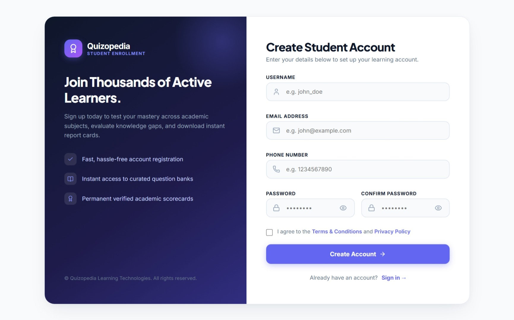
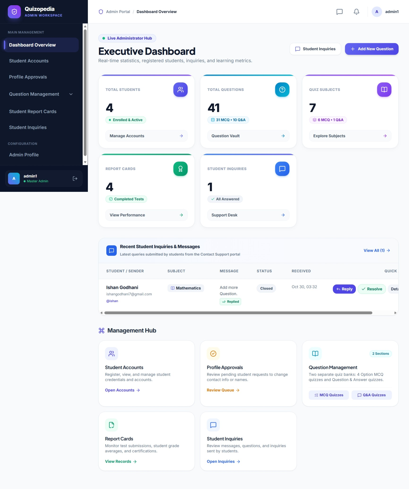
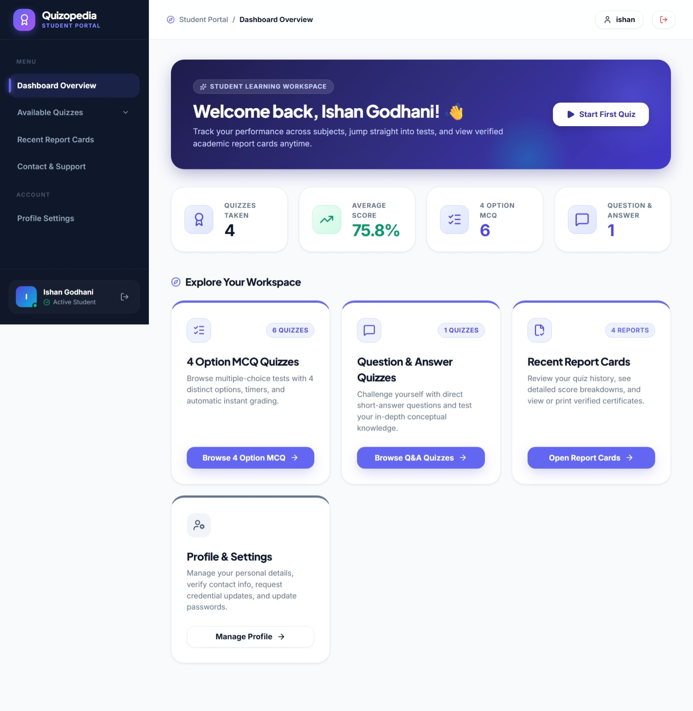

# Quizopedia

Quizopedia is a comprehensive Django-based online quiz and academic assessment platform that enables students to participate in multiple-choice (4 Option MCQ) and short-answer (Question & Answer) quizzes, track real-time learning metrics, generate verified printable report cards, and provides administrators with an executive management dashboard, bulk question authoring, student profile verification, and direct SMTP email inquiry support.

## Project Features

- Dual quiz assessment formats: 4 Option Multiple Choice (MCQ) with automatic instant grading and direct Question & Answer (Q&A) for conceptual mastery
- Executive Admin Management Dashboard featuring live statistics, student roster, question vault, report cards overview, and direct inquiry management
- Student learning workspace with personalized dashboard, quiz progress meters, and dynamic subject catalogs
- Automated report card generation with comprehensive score breakdowns, percentage grading, and printable verified academic certificates
- Bulk question authoring and parser with real-time interactive previews for both 4 Option MCQ and direct Q&A quiz formats
- Subject & quiz category management with dynamic search filters, pagination, and instant quiz attempts
- Contact & Support portal enabling students to submit inquiries and receive replies delivered directly to their email via Gmail SMTP with responsive HTML email templates
- Student profile management with administrator review and approval workflows for credential updates (name, email, phone)
- Modern and responsive user interface crafted with Tailwind CSS, Lucide icons, glassmorphism card designs, and mobile-friendly navigation

## Setup Commands

### Clone Repository

```bash
git clone https://github.com/Ishan242004/Quizopedia-Report-card-generation.git
cd Quizopedia-Report-card-generation/Quizopedia
```

### Installation on macOS/Linux

```bash
# Create and activate virtual environment
python3 -m venv .venv
source .venv/bin/activate

# Install dependencies
pip install -r requirements.txt

# Create environment file
cp .env.example .env

# Run migrations
python manage.py migrate

# Start development server
python manage.py runserver
```

### Installation on Windows

```powershell
# Create and activate virtual environment
python -m venv .venv
.venv\Scripts\activate

# Install dependencies
pip install -r requirements.txt

# Create environment file
Copy-Item .env.example .env

# Run migrations
python manage.py migrate

# Start development server
python manage.py runserver
```

## LocalServer
http://127.0.0.1:8000/

## credentials

User:- admin1<br>
Email:- admin1@gmail.com<br>
Password:- admin123

## Test User Credentials

| Role | Username | Password |
|---|---|---|
| Admin / Superuser | `admin1` | `admin123` |
| Student | `ishan` | `ishan` |
| Student | `sneh` | `sneh` |

## Screenshots

### 1. Register Page


### 2. Admin Dashboard


### 3. Student Dashboard

